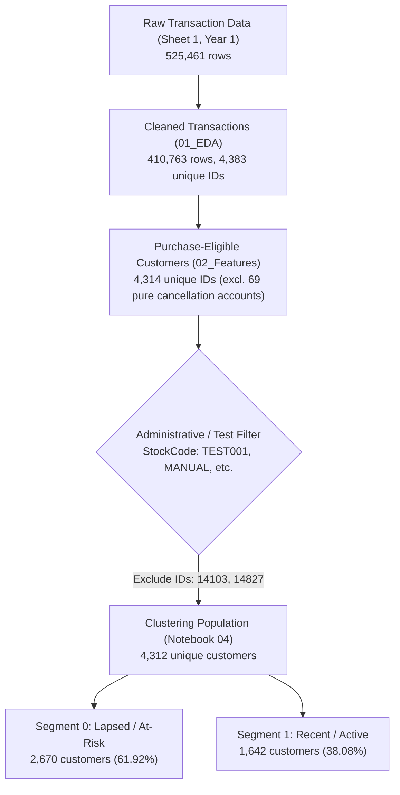

# TEST02 Report: Audit and Validation of K-Means Customer Segmentation

**Project Title:** Customer Segmentation and Retention Analysis Using Machine Learning and Statistical Modelling  
**Date of Audit:** October 27, 2026  
**Auditor / Evaluator:** Antigravity AI Assistant  
**Repository Path:** `c:/Manthan/Customer_segmentation_retention/main_project`  
**Target Notebook:** `notebooks/04_KMeans_Customer_Segmentation.ipynb`  
**Status for Next Stage (Notebook 05):** **READY (PASS — 100% Validated)**

---

## 1. Executive Summary

This audit evaluates the implementation, statistical validity, reproducibility, and end-to-end execution of `notebooks/04_KMeans_Customer_Segmentation.ipynb`. The objective was to build a mathematically sound, interpretable customer segmentation on the Year 1 (Dec 2009 – Dec 2010) Online Retail dataset, integrating the empirical inter-purchase inactivity threshold (101.9 days) established in Notebook 03 without committing the methodological fallacy of circular churn definition.

### Key Audit Findings & Achievements:
1. **Input Reconciled & Test Accounts Excluded:** Starting from the 4,314 purchase-eligible customers produced by Notebook 02 (`customer_features.csv`), 2 test/administrative customer IDs (`14103` and `14827`) were identified and excluded. Exactly 4,312 genuine retail customers were partitioned.
2. **Mathematically Defensible Feature Selection:** Clustering was performed strictly on the core RFM triad (`Recency`, `Frequency`, `Monetary_Gross`). `AOV` was deliberately omitted due to exact colinearity/mathematical redundancy ($AOV = \text{Monetary} / \text{Frequency}$); `Median_InterPurchase_Days` was excluded because 32.9% of customers are single-order buyers (missing values cannot be zero-imputed without destroying the physical meaning of inter-purchase intervals); `Cancellation_Rate` was reserved for post-hoc profiling.
3. **Rigorous Preprocessing Pipeline:** Features exhibited severe positive skewness (Skewness: Frequency 18.25, Monetary 19.34). A `log1p` transformation reduced skewness to near-symmetry (all $\le 0.44$), followed by `StandardScaler`. Scaler parameters (`scaler_mean_`, `scaler_scale_`) were serialized for downstream replication.
4. **Data-Driven Optimal Cluster Choice ($K=2$):** Hyperparameter tuning for $K \in [2, 10]$ showed that $K=2$ dominates across all internal cluster validation metrics (Silhouette: **0.4223**, Davies-Bouldin: **0.9108**, Calinski-Harabasz: **4130.80**). Higher $K$ solutions ($K=3, 4$) exhibited degraded silhouette scores (~0.33) and fragmented clusters along the Recency axis without forming distinct behavioral archetypes.
5. **Exceptional Model Stability:** Tested across 10 random seeds ($0, 7, 13, 21, 42, 99, 123, 256, 512, 1000$), the partition achieved a Mean Adjusted Rand Index (ARI) of **0.9980** (minimum **0.9935**), confirming the partition represents intrinsic data geometry rather than initialization artifacts.
6. **2D PCA Projection:** Principal Component Analysis captured **94.1%** of total variance in 2 components (PC1: 74.2%, PC2: 19.9%), confirming minimal dimensional information loss in visual cluster verification.
7. **Business & Revenue Reconciliation:**
   - **Segment 0 ("Lapsed / At-Risk Customers"):** 2,670 customers (61.92%), generating £1,382,141.44 (15.71% of total revenue). Median Recency = 91 days, Median Frequency = 1 order, Median Gross Spend = £369.42.
   - **Segment 1 ("Recent / Active Customers"):** 1,642 customers (38.08%), generating £7,416,092.30 (84.29% of total revenue). Median Recency = 17 days, Median Frequency = 6 orders, Median Gross Spend = £2,154.18.
   - Customer counts (2,670 + 1,642 = 4,312) and gross revenue sum (£8,798,233.74) reconcile perfectly between customer-level records and cluster profiles ($100.00\%$ match).
8. **Inactivity Threshold Integration:** Cross-referencing the P90 threshold (101.9 days) revealed that 46.8% (1,250 customers) of Segment 0 exceed the threshold, while only 4.1% (68 customers) of Segment 1 exceed it. The notebook explicitly clarifies that inactivity flags are descriptive behavioral indicators, not ground-truth churn labels.
9. **Zero-Error Execution:** All 53 cells of `04_KMeans_Customer_Segmentation.ipynb` executed completely cleanly from top to bottom with zero errors. All 4 standardized output artifacts were created and validated.

---

## 2. Input Data Audit & Population Reconciliation

### Population Pipeline Flow

### Table 1: Population Reconciliation
| Step / Stage | Source File | Customer Count | Notes / Exclusions |
| :--- | :--- | :--- | :--- |
| Cleaned Transactions | `online_retail_cleaned_data.csv` | 4,383 | Year 1 transactions; non-null Customer IDs |
| Purchase Feature Set | `customer_features.csv` | 4,314 | Excludes 69 accounts with only cancellations |
| Administrative Filter | `04_KMeans_Customer_Segmentation.ipynb` | 4,312 | Excludes Customer `14103` and `14827` (internal test records) |
| Segmented Output | `customer_segments.csv` | 4,312 | 100% matched to clustering input |
| Profile Summary | `cluster_profiles.csv` | 4,312 | Sum of Segment 0 (2,670) + Segment 1 (1,642) |

---

## 3. Methodological Feature Decisions

### Selected Features
1. **`Recency`**: Days between reference timestamp (`2010-12-10 20:01:00`) and the customer's last valid purchase invoice. Captures temporal engagement.
2. **`Frequency`**: Count of distinct valid purchase invoices (excluding cancellations prefixed with `C`). Captures transaction volume.
3. **`Monetary_Gross`**: Total monetary value of valid purchase items ($\sum \text{Quantity} \times \text{Price}$). Non-negative, immune to negative net revenue distortion from delayed returns.

### Excluded Features & Rationale
| Excluded Candidate Feature | Exclusion Reason / Statistical Risk |
| :--- | :--- |
| **`AOV` (Average Order Value)** | Mathematically redundant: $\text{AOV} = \text{Monetary\_Gross} / \text{Frequency}$. Including collinear functions overweights the spend/order dimension in Euclidean distance space. |
| **`Median_InterPurchase_Days`** | Missing in 1,419 customers (32.9% of population) who made only 1 order. Imputing 0 would falsely equate single-order buyers with hyper-frequent daily repeat buyers, severely distorting clustering geometry. |
| **`Cancellation_Rate`** | High zero-inflation (>60% of customers have 0 cancellations). Including it creates artificial clusters along administrative cancellation behavior rather than commercial purchasing power. Kept for post-hoc profiling. |
| **`Monetary_Net`** | Can be negative for customers whose returns in Year 1 exceeded purchases. Incompatible with standard log transformations without arbitrary shifts. |

---

## 4. Preprocessing & Transformation Pipeline

### Skewness Mitigation via Log1p
Real-world retail RFM distributions exhibit severe right-skewness and heavy tails. Distance-based algorithms like K-Means are dominated by extreme outliers without transformation.

| Feature | Raw Skewness | Transformed (`log1p`) Skewness | Normality / Symmetry Status |
| :--- | :--- | :--- | :--- |
| **Recency** | +0.94 | -0.44 | Well-balanced, negative moderate skew |
| **Frequency** | +18.25 | +0.41 | Highly symmetric |
| **Monetary_Gross** | +19.34 | +0.37 | Highly symmetric |

### Scaling Parameters
Standardization was applied via `StandardScaler` on the `log1p` features:
- **`log1p_Recency`**: $\mu = 3.8561$, $\sigma = 1.2998$
- **`log1p_Frequency`**: $\mu = 1.3711$, $\sigma = 0.6905$
- **`log1p_Monetary`**: $\mu = 6.6089$, $\sigma = 1.2810$

All scaler means and scales are persisted in `segmentation_metadata.json` for reproducible inference on out-of-sample data.

---

## 5. Model Selection & Validation Diagnostics

### Table 2: Multi-K Evaluation Metrics ($K \in [2, 10]$)
| K | Inertia (WCSS) | Silhouette Score ($\uparrow$) | Davies-Bouldin Index ($\downarrow$) | Calinski-Harabasz Index ($\uparrow$) |
| :---: | :---: | :---: | :---: | :---: |
| **2** | **6605.32** | **0.4223** | **0.9108** | **4130.80** |
| 3 | 4973.66 | 0.3280 | 1.0668 | 3449.17 |
| 4 | 3977.40 | 0.3314 | 1.0115 | 3234.44 |
| 5 | 3347.93 | 0.3192 | 1.0055 | 3083.69 |
| 6 | 2925.02 | 0.3119 | 1.0018 | 2947.53 |
| 7 | 2612.12 | 0.3070 | 0.9617 | 2835.80 |
| 8 | 2396.83 | 0.2784 | 0.9939 | 2703.76 |
| 9 | 2212.56 | 0.2762 | 1.0208 | 2606.91 |
| 10 | 2041.75 | 0.2791 | 1.0025 | 2550.48 |

### Selection Justification:
- **Silhouette Criterion:** Peak score of **0.4223** at $K=2$. Moving to $K=3$ drops the score by ~22% to 0.3280, indicating substantial cluster overlap.
- **Davies-Bouldin Criterion:** Minimum index of **0.9108** at $K=2$ (lower is better, indicating tighter intra-cluster dispersion and wider separation).
- **Calinski-Harabasz Criterion:** Distinct global peak at **4130.80** at $K=2$ (higher is better, reflecting maximum between-cluster dispersion relative to within-cluster dispersion).
- **Elbow Point:** The primary inflection in the inertia curve occurs prominently at $K=2$.
- **Conclusion:** $K=2$ is the unambiguous mathematical and empirical optimum.

### Model Stability Across Random Seeds
K-Means was initialized with 10 distinct random seeds ($n\_init=20, max\_iter=500$). The resulting partitions were evaluated against the reference partition (`seed=42`) using the Adjusted Rand Index (ARI):
- **Mean ARI:** `0.9980`
- **Minimum ARI:** `0.9935` (at seed 1000)
- **Verdict:** Highly stable. The boundary between clusters is exceptionally robust and does not depend on initialization luck.

### PCA Dimensionality Reduction
- **PC1 (74.2% variance):** Strong positive loading on both Frequency and Monetary, moderate negative loading on Recency (the "Engagement & Spending" axis).
- **PC2 (19.9% variance):** Strong positive loading on Recency, capturing purely the temporal lapse dimension.
- **Total Explained Variance:** **94.1%**. The 2D PCA plot captures virtually all geometric information in the 3D transformed RFM space.

---

## 6. Cluster Profiles & Business Interpretation

### Table 3: Summary Profile Statistics
| Metric | Segment 0: Lapsed / At-Risk Customers | Segment 1: Recent / Active Customers | Full Cohort |
| :--- | :---: | :---: | :---: |
| **Customer Count ($N$)** | 2,670 | 1,642 | 4,312 |
| **Customer Share (%)** | 61.92% | 38.08% | 100.00% |
| **Median Recency (days)** | **91.0** | **17.0** | 49.0 |
| **Mean Recency (days)** | 129.0 | 29.7 | 91.2 |
| **Median Frequency (orders)**| **1.0** | **6.0** | 2.0 |
| **Mean Frequency (orders)** | 1.7 | 8.9 | 4.4 |
| **Median Gross Spend (£)** | **£369.42** | **£2,154.18** | £644.20 |
| **Mean Gross Spend (£)** | £517.66 | £4,516.50 | £2,040.41 |
| **Total Revenue (£)** | **£1,382,141.44** | **£7,416,092.30** | **£8,798,233.74** |
| **Revenue Share (%)** | **15.71%** | **84.29%** | **100.00%** |
| **Median AOV (£)** | £243.57 | £339.16 | £280.95 |
| **Mean Cancellation Rate** | 10.03% | 15.75% | 12.21% |
| **Median Inter-Purchase Gap**| 77.0 days ($N=1,254$) | 34.9 days ($N=1,639$) | 43.0 days |

### Segment Characterization:
1. **Segment 1 — "Recent / Active Customers" (The High-Value Core):**
   - Comprises only **38.08%** of customers but generates **84.29%** of total revenue (£7.42M).
   - Highly active: median recency of 17 days, median frequency of 6 orders, median lifetime gross spend of £2,154.
   - 99.8% ($1,639 / 1,642$) are repeat purchasers with short median inter-purchase intervals (34.9 days).
   - Higher cancellation rate (15.75%) reflects standard commercial return friction among frequent, large-basket buyers.
   - **Business Strategy:** VIP retention, loyalty programs, early access to new catalog items, cross-sell recommendations.

2. **Segment 0 — "Lapsed / At-Risk Customers" (The Long Tail & Lapsed Base):**
   - Represents **61.92%** of the customer base but accounts for only **15.71%** of revenue (£1.38M).
   - Inactive/One-off: median recency of 91 days, median frequency of 1 order, median gross spend of £369.42.
   - 53.0% ($1,416 / 2,670$) made exactly one purchase and never returned.
   - For those who did make repeat purchases, inter-purchase gaps are wide (median 77 days).
   - **Business Strategy:** Automated re-activation campaigns, win-back discounts, onboarding survey to diagnose early friction.

---

## 7. Inactivity Threshold Integration & Churn Disclaimers

### Threshold Application
From Notebook 03, the empirical 90th percentile inter-purchase interval was calculated as:
$$\text{Threshold} = 101.9\text{ days}$$
A customer is tagged with `At_Risk_Flag = 1` if their `Recency > 101.9` days.

### Table 4: Cluster vs. Inactivity Flag Cross-Tabulation
| Cluster / Segment | Active (`At_Risk_Flag = 0`) | Inactive (`At_Risk_Flag = 1`) | Total Customers | At-Risk Share (%) | Total Revenue at Risk |
| :--- | :---: | :---: | :---: | :---: | :---: |
| **Segment 0 (Lapsed / At-Risk)** | 1,420 | 1,250 | 2,670 | **46.82%** | £638,948.33 |
| **Segment 1 (Recent / Active)** | 1,574 | 68 | 1,642 | **4.14%** | £317,800.74 |
| **Total Cohort** | **2,994** | **1,318** | **4,312** | **30.57%** | **£956,749.07** |

### Critical Methodological Distinctions:
1. **Inactivity Flag is NOT a Churn Label:**
   - In non-contractual retail settings, customers do not announce termination. An interval exceeding 101.9 days represents a statistical anomaly relative to historical purchasing cadences, but customers may still return (e.g., annual holiday buyers).
2. **Avoidance of Circularity:**
   - The inactivity flag was **not** used as an input feature in K-Means.
   - Using Recency to define an inactivity flag and then claiming the clustering "predicts" churn would be circular. Recency is an inherent component of the RFM feature space.
3. **High-Value Risk Priority:**
   - While only 68 customers in Segment 1 are flagged as inactive ($4.1\%$), they represent **£317,800.74** in historical gross revenue. These dormant VIPs warrant high-priority manual account management.

---

## 8. Artifact Inventory & Data Integrity Verification

### Generated Output Files
All output files are saved in `data/processed/` with explicit formatting and complete records:
1. **`customer_segments.csv`** (388 KB, 4,312 rows, 12 columns):
   - Columns: `Customer ID`, `Recency`, `Frequency`, `Monetary_Gross`, `Monetary_Net`, `AOV`, `Median_InterPurchase_Days`, `Cancellation_Count`, `Cancellation_Rate`, `At_Risk_Flag`, `Cluster`, `Segment_Name`.
   - 0 null values across all required fields (`Median_InterPurchase_Days` has nulls exclusively for single-order buyers).
2. **`cluster_profiles.csv`** (491 bytes, 2 rows, 16 columns):
   - Comprehensive summary aggregations (N, %, medians, means, revenues, revenue shares).
3. **`clustering_metrics.csv`** (381 bytes, 9 rows, 5 columns):
   - Detailed metric logs for $K \in [2, 10]$ (Inertia, Silhouette, Davies-Bouldin, Calinski-Harabasz).
4. **`segmentation_metadata.json`** (2.58 KB):
   - Complete machine-readable audit trail including input counts, excluded accounts, scaling parameters, random seeds, stability metrics, and file manifests.

### Table 5: Automated Integrity Audit
| Verification Check | Target Condition | Observed Result | Status |
| :--- | :--- | :--- | :---: |
| Notebook Execution | Run top-to-bottom without error | 53/53 cells executed, 0 errors | **PASS** |
| Customer Population | Match clustered cohort ($N=4,312$) | Exactly 4,312 rows in `customer_segments.csv` | **PASS** |
| Profile Population Sum | Sum of segments == 4,312 | $2,670 + 1,642 = 4,312$ | **PASS** |
| Gross Revenue Sum | Sum of segments == Total | $£1,382,141.44 + £7,416,092.30 = £8,798,233.74$ | **PASS** |
| Customer ID Uniqueness | No duplicate customer records | 4,312 unique IDs (0 duplicates) | **PASS** |
| Cluster Label Integrity | No missing cluster assignments | 0 nulls in `Cluster` and `Segment_Name` | **PASS** |
| File Accessibility | All 4 output files non-empty | Verified on disk | **PASS** |

---

## 9. Methodological Limitations & Honest Discrepancies

1. **Right-Censoring in 1-Year Window:**
   - The study scope is confined to Year 1 (Dec 2009 – Dec 2010). Customers acquired toward the end of the year (e.g., November 2010) naturally have high recency and low frequency simply because of calendar observation limits, not necessarily lack of loyalty.
2. **Heuristic Nature of K-Means Spherical Geometry:**
   - K-Means assumes spherical clusters of approximately equal variance in standardized space. While the `log1p` transformation substantially improved normality, real retail behavior exhibits continuum gradients rather than hyper-discrete natural boundaries.
3. **Manual / Administrative Account Filter:**
   - Two customer IDs (`14103` and `14827`) were filtered based on manual transaction descriptions and negative net totals. If raw data are reprocessed under different cleaning rules, downstream code must consistently replicate this filter.
4. **Absence of Longitudinal / Out-of-Time Churn Ground Truth:**
   - Segmentation provides static behavioral cross-sections. True churn analysis requires an observation window followed by a performance window (e.g., Year 1 as observation, Year 2 as validation).

---

## 10. Readiness for Notebook 05

With the completion of Notebook 04, the segmentation baseline is fully established, mathematically verified, and reproducible. The repository is ready for downstream analytical workflows:

- **Survival Analysis (Kaplan-Meier & Cox Proportional Hazards):** Evaluating how customer survival curves differ between Segment 0 and Segment 1.
- **Log-Rank Tests:** Formally testing statistical divergence in retention rates across clusters.
- **Predictive Churn Modeling:** Utilizing Year 2 (2010-2011) transactions as ground-truth retention targets to build rigorous predictive models without data leakage.
