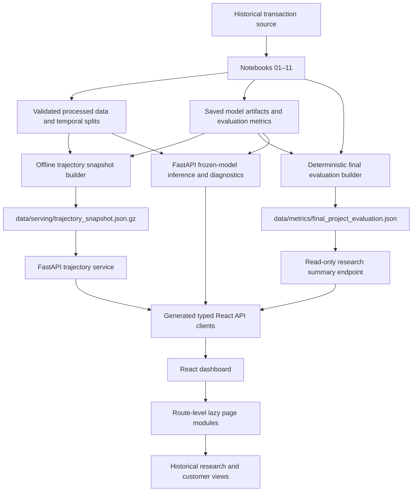

# Final system architecture

## Overview

## Responsibilities and boundaries

### Offline research and artifacts

The notebooks and their saved outputs are the scientific source of truth.
Training and method selection happen offline under the documented temporal
protocols. Phase 7 reads the saved results; it does not retrain the Purchase
Clock, spending model, behavior model, reliability model, or trajectory model.

`scripts/build_final_evaluation.py` reads the notebook source files, saved
metrics, temporal metadata, and model metadata. It creates the compact,
versioned `data/metrics/final_project_evaluation.json`. The artifact contains
aggregate results and source checksums, not customer IDs or TEST target rows.

`scripts/build_trajectory_serving_snapshot.py` applies existing saved
TRAIN-fitted trajectory transforms to historical pre-cutoff data and writes
`data/serving/trajectory_snapshot.json.gz`. It does not fit or update a model.
The compressed snapshot is 768,669 bytes in this checkout. Its schema version
and source checksums are validated when served.

### API

FastAPI retains its existing inference and diagnostics routes. The new
`GET /api/research/summary` endpoint reads the generated research JSON,
validates it against Pydantic response models, checks its source manifest, and
returns aggregate-only evidence. Missing or stale research evidence fails
explicitly with HTTP 503 rather than silently serving an outdated summary.

Trajectory endpoints read the versioned compressed snapshot instead of
reconstructing all customer windows and applying frozen models during the first
request. Request handlers perform selection, filtering, and response shaping on
the loaded immutable data. No request fits a model or writes to research
artifacts.

### Web application

The React UI uses the generated OpenAPI clients and React Query. The shell
contains shared navigation and health status; page views are loaded with
`React.lazy` and `Suspense`. Chart-heavy pages import Recharts only when needed.
Business Overview uses accessible inline SVG charts, so the landing route does
not download the large Recharts chart-generation chunk.

The Research Overview displays the generated registry, hypothesis statuses,
model metrics, population coverage, financial definitions, limitations, source
hashes, and notebook reproduction commands. It is a read-only view; filters
change only the client-side display.

## Runtime and dependency boundary

The Replit web launcher runs the API with Python 3.11 and the hash-locked
`requirements-ci.txt` dependency set. The `.replit` Python base module may be
newer, but `scripts/run-oelp-web.sh` explicitly selects Python 3.11 with `uv`,
matching the tested CI environment. Vite and the React application run under
the configured Node runtime.

The offline research workflow, frozen historical inference, saved aggregate
evaluation, hypothetical scenario calculations, and user-facing rendering are
separate boundaries. Scenario inputs never change saved predictions or imply
causal campaign results.
