# Customer Segmentation and Retention Analysis Using Machine Learning and Statistical Modelling

## Final Academic Project Report

**Student:** [Student name]  
**Faculty / supervisor:** [Faculty or supervisor name]  
**Institution:** [Institution name]  
**Programme / course:** [Programme or course]  
**Submission date:** 26 November 2026

<div class="page-break"></div>

## Abstract

This project studies repeat purchasing in the Year 1 portion of the UCI Online Retail II transaction data. Eleven connected notebooks move from transaction-quality assessment and customer feature construction to descriptive RFM segmentation, temporal validation, personalized purchase probabilities, expected spending, behavioural indicators, prediction reliability, revenue screening, and customer purchase trajectories. The study is retrospective: the official prediction cutoff is 10 September 2010, the locked TEST cohort contains 3,373 customers at each 30-, 60-, and 90-day horizon, and the outcome windows mature on different dates.

The saved Personalized Purchase Clock is a discrete-time hazard model evaluated against Global and Segment-aware alternatives. On the locked TEST cohort it achieved ROC-AUC values of 0.720882, 0.721767, and 0.719368 at 30, 60, and 90 days, respectively. The corresponding average precision values were 0.537588, 0.716292, and 0.784723; Brier scores were 0.178534, 0.214200, and 0.215308. The saved Personalized two-stage expected-spending forecast had the lowest TEST mean absolute error among the saved spending comparators at each horizon, while its negative mean bias and aggregate underprediction increased with horizon. These are historical cohort diagnostics, not current forecasts or individual guarantees.

Behavioural hypotheses were mixed: the unusual-gap and falling-revenue-rate findings were supported in multiple horizons; two comparisons were inconclusive; and the conditional behavior-plus-Purchase-Clock hypothesis was not evaluable because a chronologically eligible saved Purchase Clock vintage was unavailable. Revenue screening did not establish predictive ranking superiority on locked TEST. Reference-based revenue exposure remains not estimable, and campaign scenario outputs depend on hypothetical inputs rather than measured causal effects. Notebook 11 selected three descriptive trajectory-shape clusters; 1,100 TEST customers met that method’s support rule, while 659 TEST curves were eligible for functional PCA. Its 98.82% explained variance is TRAIN-fitted; TEST reconstruction RMSE is reported separately as 0.006248.

The accompanying React/FastAPI application serves saved model artifacts and aggregate evaluations without executing research notebooks during ordinary requests. The main contributions are an auditable temporal evaluation pipeline, a multi-method view of customer purchasing, explicit reliability and evidence boundaries, and a reproducible research dashboard. Short, left-truncated histories, sparse customer records, and the absence of treatment-response data limit interpretation. No causal retention effect or prospective business performance is claimed.

**Keywords:** customer analytics; RFM; purchase timing; hazard models; probability calibration; functional data analysis; retention decision support.

<div class="page-break"></div>

## Contents

1. Introduction  
2. Problem Statement and Objectives  
3. Literature Review  
4. Dataset and Preprocessing  
5. Proposed Methodology  
6. System Architecture  
7. Results and Discussion  
8. Website and Dashboard Implementation  
9. Testing and Validation  
10. Research Limitations  
11. Conclusion and Future Scope  
Appendices: evidence register, reproducibility, and terminology

<div class="page-break"></div>

# Chapter 1 — Introduction

Customer retention is the continuation of a commercial relationship over time. In non-contractual retail, however, a customer does not formally announce that the relationship has ended. A long gap without an observed transaction may reflect an ordinary purchasing cycle, a seasonal pause, a change in need, a move to another seller, or simply the end of the observation window. This makes “churn” harder to define than in a subscription service, where cancellation can be observed directly. For this reason, the project frames the main predictive target as whether an eligible customer makes at least one observed purchase within a specified future horizon. Non-purchase within 30, 60, or 90 days is not a permanent-churn label.

Transaction histories can be summarized through recency, frequency, and monetary value (RFM). Recency describes the time since a customer's latest purchase at a defined cutoff; frequency summarizes purchase events within the available history; and monetary value summarizes recorded spend under the project's transaction rules. These features make large customer tables easier to inspect and support descriptive segmentation. They cannot by themselves represent customer motivation, satisfaction, price sensitivity, or response to an intervention. Static clusters are therefore treated as descriptive groupings, not as risk ranks or action recommendations.

Repeat purchasing also has a temporal structure. Customers differ in their typical interpurchase gaps, the amount of history available, and how their purchase and spending rates evolve. A fixed inactivity threshold treats the same number of days as equally meaningful for all customers. A personal-gap comparison instead asks whether the current gap is unusual relative to a customer's observed history, while a finite-horizon hazard model estimates the conditional chance of a purchase over time. Both approaches require sufficiently informative history and an explicit observation boundary.

The project combines descriptive analysis, prediction, reliability assessment, and hypothetical retention planning, but keeps those questions separate. A probability forecast is evaluated against a matured future outcome. Expected revenue is an estimate formed from purchase probability and conditional spending. Reliability diagnostics ask whether predicted probabilities correspond to observed frequencies at the cohort level. A retention scenario changes hypothetical response and cost assumptions; it is not evidence that an actual campaign would produce the same effect. The project’s research contribution is therefore not a claim that one model solves retention. It is a documented and testable framework for turning historical transactions into carefully bounded evidence.

<div class="page-break"></div>

# Chapter 2 — Problem Statement and Objectives

## Problem statement

Retailers often need to prioritize customer analysis despite incomplete histories and uncertain purchase timing. A single fixed inactivity rule can overstate risk for customers whose normal purchase intervals are long, while a static segment can conceal important differences in the time structure of purchasing. A useful analytical system should describe customers, forecast finite-horizon purchasing, expose forecast reliability, and make the assumptions behind financial screening visible. It should also prevent later transactions from leaking into earlier forecasts.

The research problem addressed here is: **How can historical transaction records be organized into a reproducible customer-analysis pipeline that describes purchasing patterns, estimates bounded future purchase and spending outcomes, and communicates the reliability and limitations of those estimates?**

## Objectives

1. Inspect transaction quality, missing identifiers, cancellations, returns, and sparse histories before customer-level modeling.
2. Construct customer-level RFM, purchase-gap, and spending features while preserving unsupported values as missing rather than imputing invented histories.
3. Compare descriptive RFM groups and interpurchase distributions without treating them as prospective churn labels.
4. Define outcome-matured chronological TRAIN, VAL, and TEST partitions for the 30-, 60-, and 90-day purchase tasks.
5. Evaluate saved Global, Segment-aware, and Personalized Purchase Clock outputs using discrimination, precision-recall, probability scores, and calibration diagnostics.
6. Evaluate expected future spending separately from purchase probability and realized historical revenue.
7. Examine continuous behavioural indicators, model reliability, feature sensitivity, revenue screening, and purchasing trajectories.
8. Deliver a read-only research overview and frozen-model inference dashboard that exposes saved evidence and its provenance.

The work distinguishes four types of output: **descriptive** summaries of observed transactions; **predictive** estimates evaluated on held-out historical outcomes; **reliability** diagnostics for cohort-level forecast behaviour; and **hypothetical** scenarios whose response, uplift, budget, or margin inputs are supplied as assumptions. Only the first three are measured from project records. Scenario results are not observed treatment effects.

<div class="page-break"></div>

# Chapter 3 — Literature Review

## 3.1 RFM and customer segmentation

RFM is a compact representation of transaction history, not a complete model of customer intent. Reviews describe both score-based approaches and algorithmic segmentation, while applied retail studies show that feature choices, scaling, and the selected clustering procedure shape the resulting groups. A cluster-quality statistic answers a geometric question about the representation; it does not establish that a segment is a useful target, predicts future purchasing, or responds to a campaign. The project's two-cluster K-means result is consequently reported as descriptive and is evaluated for reproducibility and stability, not as a churn classifier. [@salminen-2023-segmentation-review] [@ernawati-2021-rfm-review] [@uk-retail-clustering-2023] [@sarvari-2016-rfm-comparison]

## 3.2 Purchase timing, gaps, and hazard models

Non-contractual customer-base research models repeated purchases under incomplete observation. Recurrent-event formulations can use the calendar-time history of multiple transactions; other probabilistic approaches estimate customer activity and future purchasing from transaction summaries. Research on timing regularity treats the pattern of interpurchase intervals as additional information, rather than assuming recency and frequency fully describe a customer's process. These are different model families with assumptions about event timing, observation, and heterogeneity. They motivate testing customer-specific purchase timing, but they do not identify a universally best model for this dataset. [@bijwaard-franses-paap-repeated-events] [@platzer-reutterer-2016-timing] [@batislam-denizel-filiztekin-2007-validation] [@fader-hardie-2009-customer-base]

## 3.3 Prediction metrics and probability calibration

Discrimination and probability accuracy are different questions. ROC-AUC measures ranking across thresholds; precision-recall measures focus on positive predictions and are affected by event prevalence. Neither metric is universally superior independent of the target and intended use. Proper probability scores such as the Brier score assess the numerical predictions against observed outcomes, while calibration compares predicted probabilities with empirical event rates. Calibration results depend on the evaluation definition and sample support, so reliability plots and named summary measures should be reported together. [@saito-rehmsmeier-2015-pr-roc] [@silva-filho-2023-calibration-survey] [@brier-1950-probability-score]

Feature explanations also need a precise target. A feature substitution or attribution describes how a fitted model's output changes under a specified procedure. It does not show that changing the feature would cause an outcome to change, and it does not identify customer intent. The project therefore labels feature sensitivity as a model diagnostic and keeps it separate from causal interpretation. [@ma-tourani-2020-shapley] [@silva-filho-2023-calibration-survey]

## 3.4 Behavioural change and functional data analysis

Change-point methods and functional data analysis address structured observations over time, but they are not interchangeable. An offline change-point method partitions an observed series under a chosen cost and penalty; sequential monitoring evaluates incoming observations relative to a monitoring rule. Published computational guarantees are conditional on the specified optimization problem and assumptions. Functional data analysis instead represents an observation as a curve, with smoothing, alignment, sparse sampling, and dimension reduction influencing the resulting scores and clusters. These methods support analytical questions about temporal shape; they do not make sparse histories dense or turn retrospective patterns into operational alerts. [@aminikhanghahi-cook-2017-changepoints] [@killick-2012-pelt] [@gertheiss-et-al-2024-functional-data-review] [@fda-systematic-review-2013]

## 3.5 Customer value, retention decisions, and causal evidence

Customer lifetime value and retention frameworks connect future customer activity to resource allocation, but estimates depend on the customer relationship setting and the model's assumptions. A predicted risk is not the same quantity as a customer's responsiveness to a retention action. Research on retention targeting highlights this distinction; randomized churn-management studies provide evidence about a particular intervention and population, not a transferable effect for every retailer. The project’s scenario calculator therefore treats response and uplift as explicit assumptions. Estimating causal campaign impact would require randomized or otherwise defensible causal evidence, plus appropriate cost and margin accounting. [@casteran-meyer-waarden-reinartz-2021-clv-review] [@ascarza-2018-retention-futility] [@godinho-matos-2018-randomized-retention] [@gordon-et-al-2019-ad-measurement]

## 3.6 Research gap and project positioning

The literature supports multiple ways to summarize and model purchase histories but does not remove the need to specify a cohort, time cutoff, target, and validation design. This project contributes an integrated historical case study with a frozen TEST evaluation, explicit population counts, model reliability diagnostics, and a serving layer that exposes aggregate evidence. It does not claim a new general-purpose segmentation or retention algorithm, a causal effect, or superiority over models not represented in the saved evaluation.

<div class="page-break"></div>

# Chapter 4 — Dataset and Preprocessing

## 4.1 Source and study window

The source is the UCI Machine Learning Repository's Online Retail II dataset, donated by Daqing Chen. The repository describes transactions from a UK-based, non-store online retailer over 1 December 2009 to 9 December 2011. This project uses the Year 1 portion only, with the observed analysis window 1 December 2009 through 9 December 2010. The saved evaluation records 19,213 valid invoice events and 4,312 customers in the full-period descriptive RFM segmentation. The official predictive TEST cutoff is 10 September 2010. [@chen-uci-online-retail-ii] [ER-01](./RESEARCH_EVIDENCE_REGISTER.md#er-01-study-scope)

The dataset is a transactional record, not a panel designed to observe customer acquisition or termination. The first transaction visible for a customer may precede the start of the file, so “first observed purchase” is not necessarily the acquisition date. At the end of the file, a subsequent purchase may be censored because it occurs outside the observation window. These boundaries matter for recency, frequency, interpurchase gaps, and customer-level forecasts.

## 4.2 Cleaning and transaction interpretation

The source contains product-line rows, so multiple records can share one invoice. Invoice identifiers beginning with `C` are cancellation/return-related, and negative quantities can represent returns or adjustments. The exploratory notebook distinguishes these records from valid purchase events instead of treating every row as a sale. It retains customer-linked cancellation information when that behavior is analyzed and excludes non-`C` negative-quantity rows from the cleaned purchase history under the documented decision. Records with missing Customer ID are not assigned invented identifiers. The notebook reports 107,927 missing customer identifiers (20.54% of rows); those records cannot be used to form an attributable customer history.

The cleaning sequence inspects invoice types, stock codes, descriptions, quantities, prices, dates, and Customer ID before applying customer-level rules. Invoice lines are aggregated into customer and invoice-level records for the analyses that require purchase events. Feature definitions distinguish gross purchasing from return/cancellation behavior where relevant. Missing recency or interpurchase-gap features remain unsupported when the observed history cannot provide them; a one-purchase history does not contain an interpurchase interval. Detailed transformation rules and source checks are recorded in Notebooks 01–02 and their reproducibility outputs.

## 4.3 Population definitions

Three populations must not be conflated. First, full-period descriptive analysis uses customer-linked observations across the Year 1 snapshot; the descriptive K-means segmentation covers 4,312 customers. Second, predictive metrics use the locked historical TEST cohort of 3,373 customers at each Purchase Clock and spending horizon. Third, Notebook 11 applies narrower method-specific support rules: 1,306 TEST customers support the summary-trajectory comparison, 1,100 support the selected shape-clustering solution, and 659 support functional curves. These counts differ because each method needs different observed history and are not interchangeable. [ER-01](./RESEARCH_EVIDENCE_REGISTER.md#er-01-study-scope) [ER-02](./RESEARCH_EVIDENCE_REGISTER.md#er-02-temporal-cohorts) [ER-10](./RESEARCH_EVIDENCE_REGISTER.md#er-10-trajectory-support)

## 4.4 Currency and target interpretation

Transaction value is represented in GBP in the saved spending and revenue evaluation. For a horizon H, the purchase target is whether at least one observed purchase occurs in the future window. Expected revenue is an estimate for that horizon, not historical revenue and not a promise for any individual. No randomized marketing-treatment, contact-response, or control-group field is present in the saved project evidence.

<div class="page-break"></div>

# Chapter 5 — Proposed Methodology

## 5.1 Notation and temporal protocol

Let i index customers, t₀ denote a forecast cutoff, H a horizon in days, Xᵢ(t₀) the information available on or before the cutoff, Yᵢ,ᴴ an indicator of at least one observed purchase during the outcome window, and Sᵢ,ᴴ the spending outcome under the project's saved definition. Predictions use Xᵢ(t₀) only. TRAIN and VAL cutoffs are chosen so the associated outcome windows have matured before each evaluation step; the final TEST cohort is locked at t₀ = 10 September 2010. The different horizon windows use different TRAIN and VAL cutoffs, and the 30-, 60-, and 90-day results are not treated as the same target. [ER-02](./RESEARCH_EVIDENCE_REGISTER.md#er-02-temporal-cohorts)

## 5.2 RFM features and K-means

At a defined cutoff, customer recency is **Rᵢ(t₀) = t₀ − max{t: customer i has a valid purchase at t}**.

Frequency Fᵢ(t₀) is the number of distinct valid purchase events available before the cutoff, while monetary value Mᵢ(t₀) is the sum of purchase value under the feature pipeline's documented treatment of returns. RFM is a representation of observed behavior. Any transformation or scaling is fitted according to the notebook's analysis rules; group labels derived from the full-period dataset are retrospective and are not used as a forecast-time segment unless the cutoff-specific pipeline defines one.

For standardized customer vectors zᵢ, K-means selects cluster centers μ₁,…,μₖ to minimize within-cluster squared Euclidean distance:

K-means minimizes **Σₖ Σᵢ∈Cₖ ‖zᵢ − μₖ‖²**, assigning each standardized customer vector to its closest center.

The selected K and cluster labels depend on representation, scaling, initialization, and validation criteria. The project reports the saved two-cluster RFM segmentation for 4,312 descriptive customers and seed-stability ARI values; it does not interpret those clusters as a probability of churn or as evidence of intervention response. [ER-04](./RESEARCH_EVIDENCE_REGISTER.md#er-04-rfm-segmentation)

## 5.3 Interpurchase distributions

For each customer with at least two valid purchase events, the positive interpurchase gap is **Δᵢⱼ = tᵢⱼ − tᵢ,ⱼ₋₁**, where tᵢⱼ is the time of the j-th observed purchase. Candidate parametric distributions are fitted to observed positive gaps and compared using the saved fit diagnostics. The Gamma candidate has the lowest saved AIC among the compared distributions, and the empirical 90th percentile gap is 101.9 days. AIC is a relative criterion among the evaluated candidates and does not establish a universal data-generating process. The empirical P90 is descriptive; it is not a permanent-churn label, an alert threshold, or a recommended intervention rule. [ER-03](./RESEARCH_EVIDENCE_REGISTER.md#er-03-interpurchase-distribution)

## 5.4 Discrete-time purchase hazard

For customer i in interval t, the Personalized Purchase Clock estimates the conditional purchase hazard **hᵢₜ = P(Tᵢ=t | Tᵢ≥t, Xᵢ(t₀)) = σ(β₀+βᵀxᵢₜ)**, where **σ(u)=1/(1+e⁻ᵘ)**. Combining interval hazards gives the cumulative probability by horizon H: **P(Tᵢ≤H | Xᵢ(t₀)) = 1 − ∏ₜ₌₁ᴴ(1−hᵢₜ)**.

The saved model is evaluated against Global and Segment-aware comparators on the same locked cohort. The horizon probability estimates a finite-window event; it is not a permanent inactivity or churn probability. Model fitting and selection are offline; the serving application loads the saved artifact. [ER-05](./RESEARCH_EVIDENCE_REGISTER.md#er-05-purchase-clock)

## 5.5 Conditional spending and expected revenue

The two-stage forecast combines the saved purchase probability with conditional expected spending: **Ê[Rᵢ,ᴴ | Xᵢ] = p̂ᵢ,ᴴ × Ê[Sᵢ,ᴴ | Yᵢ,ᴴ=1, Xᵢ]**.

The saved report compares this Personalized two-stage quantity with Segment-aware two-stage and Historical spending-rate baselines. MAE, RMSE, mean forecast bias, and aggregate calibration ratio are reported separately because they answer different questions. A lower MAE does not imply no bias, and aggregate underprediction is not a loss estimate or a validated correction to the saved model. [ER-06](./RESEARCH_EVIDENCE_REGISTER.md#er-06-spending-forecast)

## 5.6 Behavioural change indicators

Notebook 08 defines continuous behavior features from the purchase history and compares behavior-only candidates with the saved Purchase Clock on a chronologically defined TEST cohort. The evidence is summarized through horizon-specific average-precision differences and customer-level bootstrap intervals. H1, unusual personal purchase gaps, and H3, falling revenue rate, are supported in multiple horizons; H2 and H4 are inconclusive. H5 is not evaluable because a saved Purchase Clock vintage eligible at the official TRAIN cutoffs does not exist. The study does not establish an operational alert policy or a causal behavioral mechanism. [ER-07](./RESEARCH_EVIDENCE_REGISTER.md#er-07-behavioral-evidence)

## 5.7 Reliability, calibration, and explanations

For binary outcomes yᵢ ∈ {0,1} and predictions pᵢ, the Brier score is **BS = (1/N) Σᵢ(pᵢ−yᵢ)²**. For bins Bₘ, expected calibration error is **ECE = Σₘ(|Bₘ|/N) × |acc(Bₘ)−conf(Bₘ)|**, the weighted absolute difference between each bin's mean prediction and observed event rate.

These are cohort-level summaries and depend on the saved binning definition. The project also reports subgroup diagnostics and customer-level bootstrap intervals for aggregate metrics. Feature substitutions in Notebook 09 compare model outputs after controlled input changes; they are model sensitivities, not causal effects or guarantees about an individual. [ER-08](./RESEARCH_EVIDENCE_REGISTER.md#er-08-reliability)

## 5.8 Revenue screening and hypothetical scenarios

Expected revenue is the saved purchase probability multiplied by saved conditional expected spending. Forecast disagreement is the difference among saved predictions. The nonreturn-weighted spending proxy is **(1−p̂ᵢ,ᴴ) × Ê[Sᵢ,ᴴ | Yᵢ,ᴴ=1, Xᵢ]** and is used only for screening; it is not recoverable revenue. Reference-based exposure requires a defensible, chronologically valid matched reference forecast. No such reference is saved, so the aggregate reference-exposure total remains `null` with status `not_estimable`. Campaign response, incremental probability, contact cost, budget, and margin are hypothetical scenario inputs. No causal effect is estimated. [ER-09](./RESEARCH_EVIDENCE_REGISTER.md#er-09-revenue-screening)

## 5.9 Customer trajectories and functional PCA

Notebook 11 constructs exposure-aware purchase and spending trajectories over repeated time windows. Shape clustering is selected using TRAIN stability and VAL silhouette criteria, with explicit minimum cluster-support constraints. A descriptive shape-cluster solution does not rank risk. Functional PCA represents a discretized curve xᵢ(t) as a mean curve plus a finite set of basis functions: **xᵢ(t) ≈ μ(t) + Σₖ₌₁ᴷ ξᵢₖφₖ(t)**.

The component scores ξᵢₖ provide a lower-dimensional representation. The number of retained components is selected on VAL reconstruction error; the PCA transform is fitted on TRAIN. Explained variance is therefore a TRAIN-fit quantity, while TEST reconstruction RMSE measures held-out curve reconstruction. Customers without the required history remain ineligible rather than being extrapolated into this analysis. The same-cohort prediction comparison with the saved Purchase Clock is standalone; its paired Brier interval includes zero and does not establish conditional incremental value. [ER-10](./RESEARCH_EVIDENCE_REGISTER.md#er-10-trajectory-support)

<div class="page-break"></div>

# Chapter 6 — System Architecture

The system separates offline research from application serving. Jupyter notebooks 01–11 document analysis, validation, and saved results. Saved model files and aggregate evaluation JSON are the scientific source of truth for the dashboard. The application does not execute notebook training cells during a request or at normal startup.

The FastAPI service loads saved artifacts for frozen inference and reads the generated final evaluation summary for research evidence. The research summary endpoint validates the evidence schema and source manifest; missing or stale evidence fails explicitly rather than silently serving stale results. Trajectory endpoints read a prebuilt, versioned compressed serving snapshot instead of reconstructing every trajectory on a cold request. Generated OpenAPI clients provide typed React access to API routes. React pages are route-split so chart-heavy code is not downloaded for every initial view.

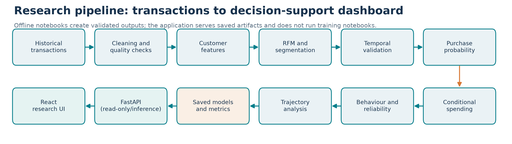

**Figure 1.** Research pipeline from historical transaction data through saved evaluations and frozen serving to the React dashboard.

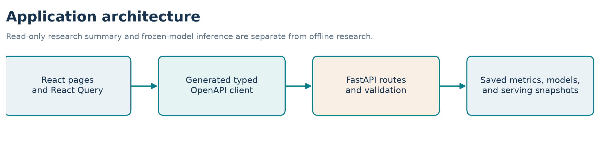

**Figure 2.** React, typed API client, FastAPI, and saved data/model artifacts.

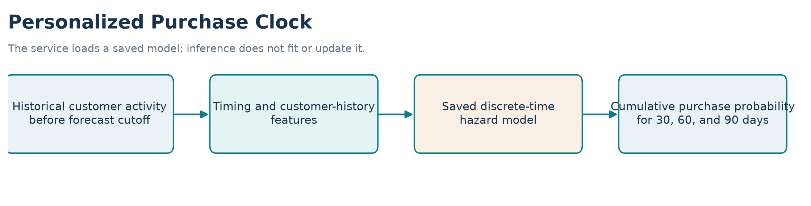

**Figure 3.** Saved purchase hazard model maps cutoff-safe features to 30-, 60-, and 90-day probabilities.

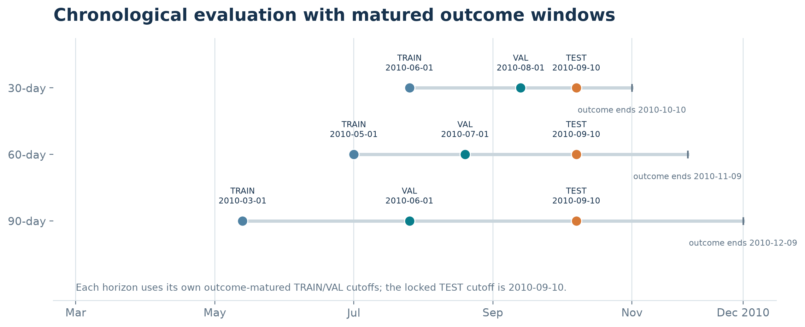

**Figure 4.** Horizon-specific TRAIN/VAL/TEST cutoffs and matured outcome windows. All TEST forecasts use the 10 September 2010 cutoff, while target end dates differ by horizon.

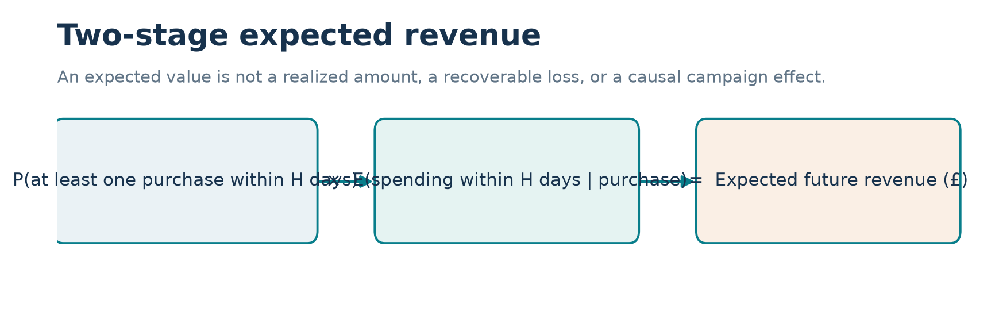

**Figure 5.** Expected future revenue is a probability-weighted conditional spending estimate, not observed sales.

The runtime uses Python 3.11 and the hash-locked `requirements-ci.txt` environment for the API and Python tests; the React workspace uses Node.js 24 and pnpm 10. No changes are made to the existing runtime launcher or `.replit` configuration. Reproducibility commands are listed in Appendix B. [ER-11](./RESEARCH_EVIDENCE_REGISTER.md#er-11-system-and-validation)

<div class="page-break"></div>

# Chapter 7 — Results and Discussion

## 7.1 Notebook-level findings

| Notebook | Main saved result | Interpretation boundary |
|---|---|---|
| 01 — Exploratory data analysis | Documents missing customer IDs, invoice types, returns, and the short observation window. | First observed purchase is not necessarily acquisition. |
| 02 — Customer feature engineering | Builds customer-level recency, frequency, monetary, order-value, gap, and return/cancellation features. | Sparse histories retain unsupported missing values. |
| 03 — Interpurchase distributions | Gamma has the lowest saved AIC (123,760); empirical P90 gap is 101.9 days. | Distribution fit and P90 are descriptive. |
| 04 — K-means segmentation | Two descriptive RFM clusters for 4,312 customers; mean seed ARI 0.998, minimum 0.9935. | Clusters are not prospective churn scores. |
| 05 — Statistical validation | Separate outcome-matured temporal cutoffs for 30-, 60-, and 90-day targets. | Horizon populations and target dates differ. |
| 06 — Personalized Purchase Clock | Personalized model leads saved comparators on ROC-AUC, average precision, and Brier score at all three horizons. | Historical TEST comparison only. |
| 07 — Spending and revenue forecasts | Personalized two-stage estimate has lowest saved MAE at each horizon. | Forecast bias and calibration still vary. |
| 08 — Behavioural change detection | H1 and H3 supported in multiple horizons; H2/H4 inconclusive; H5 not evaluable. | No operational alert policy supported. |
| 09 — Reliability and explainability | Fixed-bin calibration, bootstrap intervals, subgroup diagnostics, and model sensitivity. | Group diagnostics are not individual guarantees. |
| 10 — Revenue exposure and planning | Reference exposure not estimable; predictive ranking not supported on locked TEST. | Scenarios are hypothetical and noncausal. |
| 11 — Trajectory analysis | Three descriptive shape clusters; method-specific support; TRAIN-fitted FPCA and held-out reconstruction. | Clusters are not risk ranks; incremental value is inconclusive. |

Evidence IDs and exact source fields are listed in the accompanying research evidence register. [ER-03](./RESEARCH_EVIDENCE_REGISTER.md#er-03-interpurchase-distribution) [ER-04](./RESEARCH_EVIDENCE_REGISTER.md#er-04-rfm-segmentation) [ER-07](./RESEARCH_EVIDENCE_REGISTER.md#er-07-behavioral-evidence) [ER-10](./RESEARCH_EVIDENCE_REGISTER.md#er-10-trajectory-support)

## 7.2 Personalized Purchase Clock

The table reports the saved Personalized model on the same 3,373-customer TEST cohort at each horizon. ROC-AUC, average precision, and Brier score are intentionally separate. Average precision rises with horizon alongside the prevalence of observed purchases; this should not be read as a simple across-horizon improvement because target windows and event rates differ.

| Horizon | TEST n | ROC-AUC | Average precision | Brier score | Saved calibration error |
|---:|---:|---:|---:|---:|---:|
| 30 days | 3,373 | 0.720882 | 0.537588 | 0.178534 | 0.062646 |
| 60 days | 3,373 | 0.721767 | 0.716292 | 0.214200 | 0.061482 |
| 90 days | 3,373 | 0.719368 | 0.784723 | 0.215308 | 0.071720 |

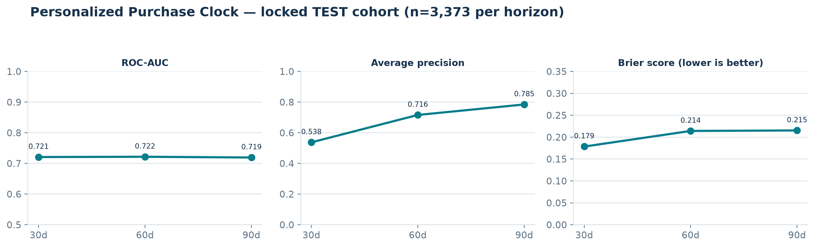

**Figure 6.** The saved Personalized model's three metrics are plotted on separate axes to avoid combining different evaluation questions.

The calibration-error column is the saved Purchase Clock evaluation metric. Notebook 09's fixed-bin ECE below uses its separately saved binning procedure and is not a replacement value for this column.

## 7.3 Expected spending and revenue

| Horizon | TEST n | MAE (£) | RMSE (£) | Mean bias (£) | Aggregate calibration ratio |
|---:|---:|---:|---:|---:|---:|
| 30 days | 3,373 | 243.18 | 871.30 | -29.96 | 0.864 |
| 60 days | 3,373 | 383.78 | 1,466.12 | -92.37 | 0.801 |
| 90 days | 3,373 | 547.38 | 2,111.73 | -187.86 | 0.746 |

The two-stage Personalized model has the lowest saved MAE at all three horizons, but negative mean bias and calibration ratios below one show aggregate underprediction in these TEST outcomes. RMSE is more sensitive to large errors than MAE. None of these metrics estimates a future customer's realized spend. The ratio is an aggregate diagnostic, not a valid correction factor for individual forecasts. [ER-06](./RESEARCH_EVIDENCE_REGISTER.md#er-06-spending-forecast)

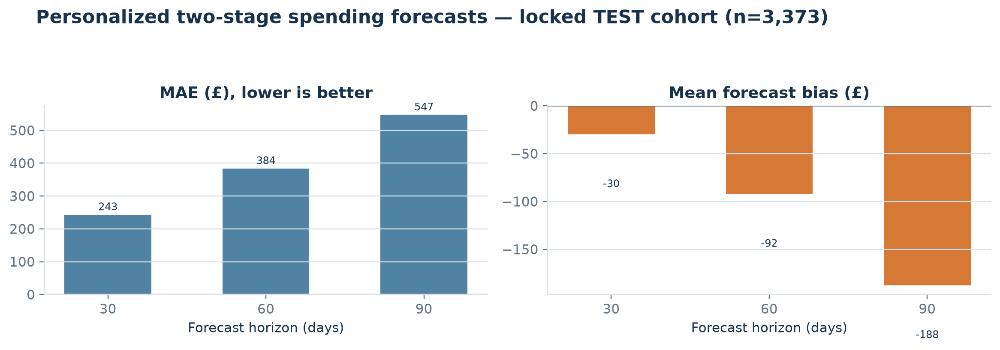

**Figure 7.** MAE and mean bias for the Personalized two-stage spending forecast. Bias is shown around zero; both metrics use GBP.

## 7.4 Behaviour and reliability

Notebook 08 assessed five predeclared hypotheses. H1 (unusually long personal gap) and H3 (falling revenue rate) were supported in multiple horizons. H2 and H4 remained inconclusive. H5, conditional incremental value after the saved Purchase Clock, was not evaluable because a chronologically eligible saved model vintage was unavailable. The separate TEST comparison of a behavior-only candidate with the Purchase Clock does not establish that behavior adds independent information.

The reliability artifact reports Brier scores of 0.178534, 0.214200, and 0.215308 for 30-, 60-, and 90-day Personalized purchase forecasts. Its fixed-bin ECEs are 0.060562, 0.062264, and 0.068906, respectively. Bootstrap intervals summarize uncertainty in aggregate metrics under the saved procedure. They do not quantify uncertainty about a particular customer's future outcome. Input substitutions are model sensitivities rather than causal feature effects. [ER-07](./RESEARCH_EVIDENCE_REGISTER.md#er-07-behavioral-evidence) [ER-08](./RESEARCH_EVIDENCE_REGISTER.md#er-08-reliability)

## 7.5 Revenue exposure and retention planning

Revenue screening keeps separate quantities separate: expected revenue, forecast disagreement, the nonreturn-weighted spending proxy, and reference-based exposure. The saved reference-exposure status is `not_estimable`, with a null total because no defensible matched reference forecast exists. The validation-selected predictive ranking hypothesis was not supported on locked TEST; the 90-day policy selection is exploratory because a prospectively eligible selection is unavailable. Hypothetical campaign scenarios vary user-supplied assumptions and do not estimate incremental probability, causal lift, recovered revenue, or profit. [ER-09](./RESEARCH_EVIDENCE_REGISTER.md#er-09-revenue-screening)

## 7.6 Trajectory clustering and functional PCA

The selected Notebook 11 trajectory-shape solution contains three descriptive clusters. The support rules admit 1,100 TEST customers for shape clustering, 1,306 for the broader summary-trajectory comparison, and 659 for functional curves. The TRAIN-fitted functional PCA accounts for 98.82% cumulative explained variance on TRAIN; TEST reconstruction RMSE is 0.006248. The variance percentage is not a TEST statistic. The paired 95% Brier-difference interval for **trajectory summary minus saved Purchase Clock** on the same 1,306-customer subset includes zero (difference −0.003969, interval [−0.012191, +0.004046]). This is inconclusive evidence, not equivalence and not proof of incremental predictive value. [ER-10](./RESEARCH_EVIDENCE_REGISTER.md#er-10-trajectory-support)

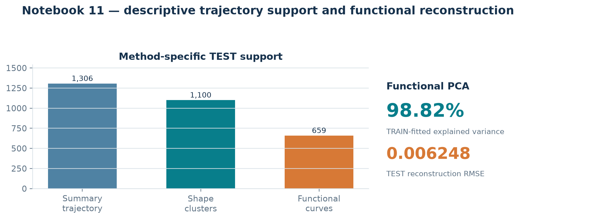

**Figure 8.** Method-specific TEST population counts are shown separately; TRAIN explained variance and TEST reconstruction error are explicitly distinguished.

## 7.7 Interpretation

The clearest predictive finding is that the saved Personalized Purchase Clock ranked above its saved comparators on the reported TEST probability metrics, while the two-stage expected-spending model reduced MAE relative to its saved baselines. These results are tied to one historical Year 1 cohort and horizon-specific targets. The behavior and trajectory analyses add useful diagnostics and descriptive structure, but neither supports a generalized operational alert or causal intervention. The project is strongest as an auditable historical research system with explicit evaluation populations and limitations.

<div class="page-break"></div>

# Chapter 8 — Website and Dashboard Implementation

The application contains ten research-facing pages. Each page connects a saved research output to a distinct user question.

| Page | URL | Role |
|---|---|---|
| Business Overview | `/` | Historical sales and customer summaries with saved forecast context. |
| Segments | `/segments` | Descriptive RFM group exploration and customer-table filters. |
| Customer Intelligence | `/intelligence` | One saved customer's history, forecasts, explanations, reliability, and behavior context. |
| Behavior Indicators | `/behavior` | Continuous behavior indicators and saved hypothesis evidence. |
| Forecasting | `/forecasting` | Global, Segment-aware, and Personalized purchase probabilities by horizon. |
| Upload Analysis | `/upload` | Upload and validation workflow for user-supplied tabular analysis. |
| Model Performance | `/model-performance` | Saved prediction metrics, calibration, and reliability summaries. |
| Revenue & Retention | `/revenue-exposure` | Expected revenue, screening proxies, and hypothetical scenarios. |
| Trajectory Explorer | `/trajectories` | Method support, descriptive clusters, and functional-analysis diagnostics. |
| Research Overview | `/research` | Notebook registry, evidence status, source provenance, and limitations. |

The customer workflow starts with a saved customer identifier, uses history up to the official cutoff for forecast inputs, displays finite-horizon purchase probabilities and conditional spending, and then shows model sensitivity and cohort reliability. Behavior indicators and trajectory results are presented only where method support exists. Retrospective panels may include transactions after the forecast cutoff and are labeled as descriptive, not forecast inputs. The example customer used in the demonstration is **18102**; the walkthrough must not expose any individual TEST outcome. [ER-11](./RESEARCH_EVIDENCE_REGISTER.md#er-11-system-and-validation)

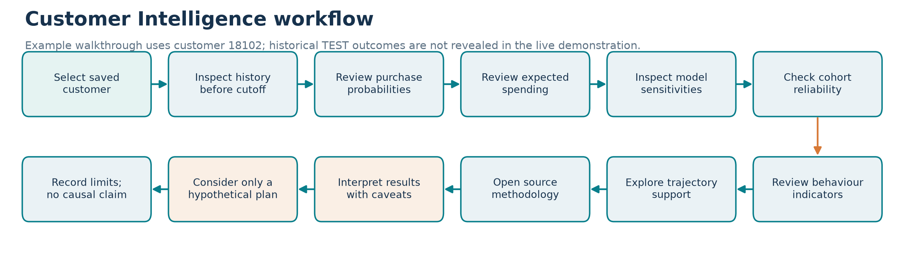

**Figure 9.** Customer workflow from saved history through predictions and interpretation, with causal and support limits kept visible.

### Dashboard screenshots

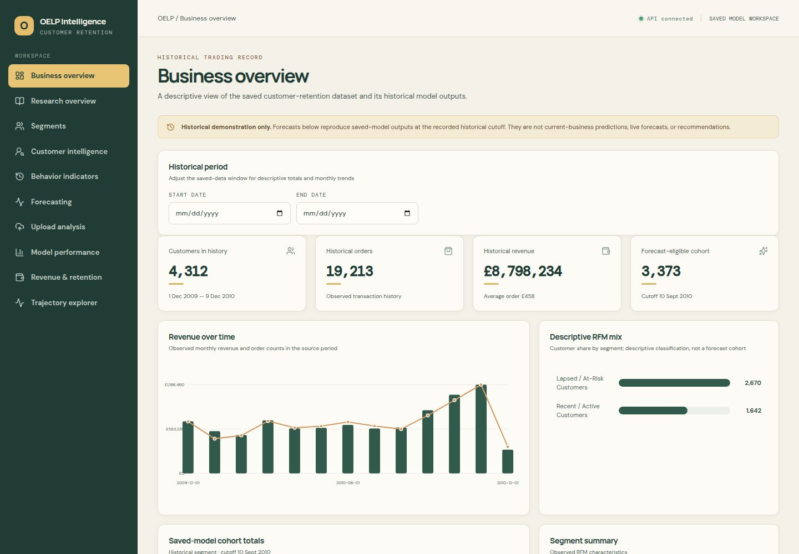

**Screenshot 1.** Business Overview captured from the running React/FastAPI development application.

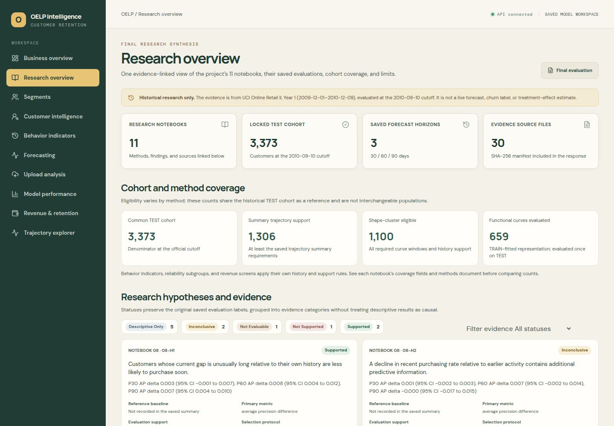

**Screenshot 2.** Research Overview displaying saved research evidence and provenance.

<div class="page-break"></div>

# Chapter 9 — Testing and Validation

## 9.1 Research artifact and prediction validation

The merged Phase 8 baseline passed 195 Python tests, 32 React tests, and 28 Chromium browser end-to-end tests. Typechecking and the production build passed. A 37-operation GET API smoke suite succeeded. The 67-file protected research/model artifact baseline matched, and saved-model parity covered all 3,373 historical forecast customers across three horizons. The Phase 9 submission branch repeated the main local quality gates: 195 Python tests, 32 React tests, 28 Chromium end-to-end tests, typechecking, production build, and read-only checks for the final evaluation and trajectory snapshot all passed. The browser suite used the workspace-provided Chromium executable. GitHub Actions on the final PR commit remain the final remote check. [ER-11](./RESEARCH_EVIDENCE_REGISTER.md#er-11-system-and-validation)

The Python suite emitted one `StarletteDeprecationWarning`: the current test client uses `httpx` and recommends `httpx2`; no test failed. The Vite production build completed without warnings.

## 9.2 Phase 9 document checks

The submission package is checked for: valid Markdown and citation keys; references with resolvable URLs and saved evidence paths; presence of all required files; 15 presentation slides with nonempty notes; readable diagram and chart assets; valid DOCX/PDF/PPTX containers; PDF page count; and no temporary branch references in academic source links. The actual browser walkthrough records the page URL, action, visible result, presenter explanation, scientific interpretation, limitation, and backup action for each demo step.

## 9.3 Reproducibility boundary

Notebook training cells are not re-executed as part of this submission task. Several notebooks create or overwrite model artifacts. Instead, validation uses the saved aggregate metrics, artifact hashes, model parity tests, API/React regression tests, browser tests, typechecking, production build, and read-only reproducibility checks. This avoids changing the scientific evidence while checking that the application and submission package remain usable.

## 9.4 API and frontend performance

The Phase 7 serving optimization moved trajectory-feature reconstruction out of the first API request and into an offline, validated serving snapshot. In the same locked Python 3.11 and four-CPU environment, the cold summary request fell from a 4,261.8 ms median to 311.9 ms (92.7% lower); the customer 18102 trajectory request fell from 4,292.6 ms to 349.8 ms (91.9% lower). Warm trajectory-summary median/p95 changed from 6.9/8.0 ms to 6.7/7.3 ms, and customer-detail warm median/p95 from 9.3/11.1 ms to 8.8/11.1 ms.

Route-level code splitting reduced the initial home-route JavaScript graph from the previous 889,810-byte bundle (240,940 bytes gzip) to 306,125 bytes (95,685 bytes gzip), a 65.6% raw and 60.3% gzip reduction. Total emitted JavaScript was 917,397 bytes across 23 files, slightly larger than the earlier single bundle, and the largest chunk fell to 396,015 bytes. Phase 8 remeasurement recorded 265.9 ms cold summary latency and 270.2 ms cold customer-trajectory latency; the initial graph was 307,062 bytes raw and 95,860 gzip. This small initial-route increase is 0.31% raw / 0.18% gzip versus the Phase 7 measurement, not a material regression.

Application process startup was not improved: process start to a healthy API response measured 3,747 ms median before and 3,907 ms after the Phase 7 serving change. The benchmark uses only three cold endpoint trials, so its values are engineering observations rather than an SLA. These results are recorded in the Phase 7 engineering report and Phase 8 remeasurement. [ER-12](./RESEARCH_EVIDENCE_REGISTER.md#er-12-performance-measurements)

<div class="page-break"></div>

# Chapter 10 — Research Limitations

The analysis window spans approximately one year for the Year 1 subset. Customer histories are short and left-truncated: purchase activity before the file begins is unobserved, so a first visible purchase cannot be assumed to be acquisition. A customer may have only one observed purchase, too few events to support an interpurchase interval, or too few repeated windows to support a trajectory curve. Missing Customer IDs prevent attribution of a portion of the records to customer histories.

All prediction results are historical. The shared TEST cutoff is 10 September 2010, and the 30-, 60-, and 90-day targets mature at different dates. Cohort equality does not make the targets equivalent, and method-specific eligibility narrows some analyses to substantially fewer customers. A score on this data does not establish performance on a modern retailer, another product category, or a prospective customer population.

Observed non-purchase during a finite horizon is not permanent churn. Descriptive RFM groups and trajectory clusters are not risk ranks. Bootstrap intervals summarize the saved aggregate metric procedure, not individual uncertainty or parameter uncertainty. The reliability analysis does not guarantee an individual forecast. Feature substitutions describe fitted-model sensitivity and are not causal explanations of customer behavior.

No treatment assignment, randomized campaign response, or matched control evidence supports a causal retention claim. Revenue exposure is not estimable because the required matched reference forecast is absent. Scenario outputs are conditional on hypothetical inputs and cannot be presented as measured uplift, recovered revenue, or profit. Finally, aggregate test performance can conceal subgroup variation, sparse histories, and errors in high-spend tails.

<div class="page-break"></div>

# Chapter 11 — Conclusion and Future Scope

This project turns a historical transaction file into a documented research pipeline that links data-quality decisions, customer features, descriptive segmentation, temporal modeling, reliability checks, revenue screening, trajectories, and a live dashboard. Its methodological contribution is the separation of tasks that are often conflated: descriptive labels are not churn scores; horizon-specific purchase probabilities are not permanent inactivity; expected revenue is not realized revenue; model sensitivity is not causality; and hypothetical retention scenarios are not campaign effects.

On the saved historical TEST cohort, the Personalized Purchase Clock is the strongest of the saved probability comparators on the listed discrimination and probability-score metrics at all three horizons. The Personalized two-stage spending forecast yields the lowest saved MAE at all horizons, but has negative mean bias and underpredicts aggregate revenue. Behavioral evidence is mixed, the H5 conditional comparison is not evaluable, the predictive ranking hypothesis in Notebook 10 is not supported on locked TEST, and trajectory incremental value remains inconclusive. The three selected shape clusters and functional components are descriptive structures that must not be used as risk ranks.

Future work should start with a longer, prospectively collected history that includes customer acquisition and exposure windows, a stable customer identifier, refunds and margins, and explicit campaign assignment and response. A randomized holdout or another defensible causal design would be required to estimate intervention effects. Additional validation should evaluate temporal drift, performance across products and customer groups, and uncertainty under sparse histories. Any future model should be compared under the same cutoff, target, cohort, and outcome-maturity rules. These extensions require new data and validation; none is assumed by the present submission.

## Appendix A — Evidence and interpretation

The companion `RESEARCH_EVIDENCE_REGISTER.md` maps each quantitative statement to the exact saved file and JSON field or notebook output. Literature references provide methodological background; they are not substitutes for project measurements. Where a source is available only as a search-result snippet, that limitation is recorded in the source registry and evidence register.

## Appendix B — Reproducibility commands

Install and start the saved application from a clean checkout:

```bash
pnpm install --frozen-lockfile
pnpm dev
```

Regenerate the report, editable deck, PDFs, and embedded presentation notes:

```bash
pnpm --filter @workspace/oelp-customer-intelligence run submission:generate
```

Run the locked Python suite and web checks:

```bash
PYTHONPATH=. uv run --no-project --python 3.11 \
  --with-requirements requirements-ci.txt pytest -q tests
pnpm test
pnpm run typecheck
pnpm --filter @workspace/oelp-customer-intelligence run build
pnpm --filter @workspace/oelp-customer-intelligence run test:e2e
```

Check the generated evaluation artifacts without writing them:

```bash
PYTHONPATH=. uv run --no-project --python 3.11 \
  --with-requirements requirements-ci.txt \
  python scripts/build_final_evaluation.py --check
PYTHONPATH=. uv run --no-project --python 3.11 \
  --with-requirements requirements-ci.txt \
  python scripts/build_trajectory_serving_snapshot.py --check
```

Notebook execution is deliberately not a routine application check. Use a disposable working copy only after inspecting its outputs, dependencies, and artifact paths.

## Appendix C — Terminology

| Term | Use in this report |
|---|---|
| Historical TEST cohort | Customers evaluated at the saved 10 September 2010 cutoff. |
| Finite-horizon purchase | At least one observed purchase during a specified 30-, 60-, or 90-day outcome window. |
| Expected revenue | Saved purchase probability multiplied by saved conditional expected spending. |
| Calibration | Agreement between forecast probabilities and observed outcome rates under the specified cohort and binning method. |
| Descriptive cluster | A group formed from observed customer features; not automatically a risk rank or intervention target. |
| Functional PCA | A TRAIN-fitted low-dimensional representation of eligible customer curves. |
| Not estimable | The saved data do not support a defensible value for the requested quantity. |
| Hypothetical scenario | A calculation conditional on user-entered assumptions, not a measured treatment effect. |
