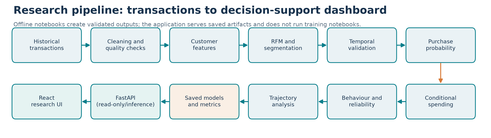
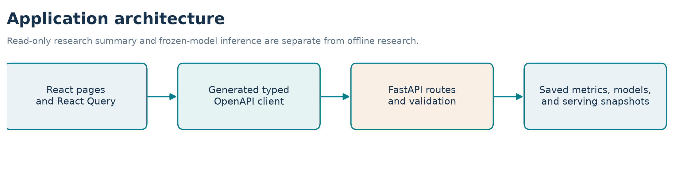
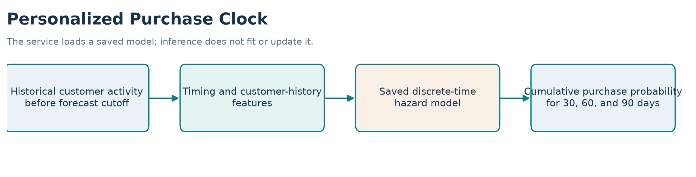
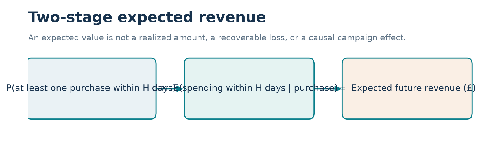
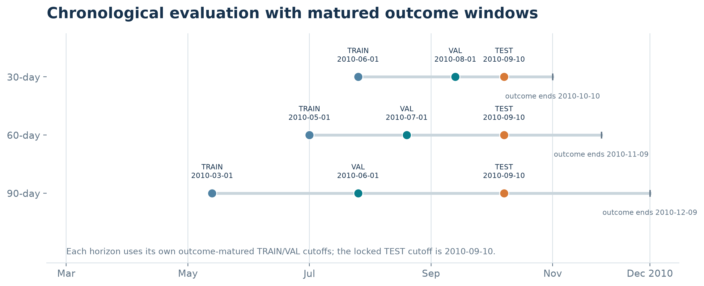

# System Architecture

## Overview

The system separates research, saved artifacts, API serving, and the React dashboard. The eleven notebooks perform offline analysis and produce model artifacts, evaluation metrics, and reproducibility evidence. The application serves frozen artifacts and saved aggregate evaluations; it does not execute notebook training as part of ordinary page loading or API requests.

## Data and evaluation flow

1. **Historical inputs:** the Year 1 UCI Online Retail II subset and its customer-linked transaction records.
2. **Offline notebooks:** notebooks 01–11 document data quality, RFM construction, temporal splits, model evaluation, behavior, reliability, revenue screening, and trajectories.
3. **Saved outputs:** frozen model artifacts, aggregate metrics, the final research evaluation registry, and the trajectory serving snapshot.
4. **FastAPI:** inference and diagnostic routes load saved model files; the research summary route reads and validates aggregate evidence and source hashes.
5. **Typed React client:** generated OpenAPI clients and React Query connect the UI to API responses.
6. **Dashboard:** ten routes provide business, segmentation, customer, forecasting, behavior, reliability, revenue, trajectory, upload, and research evidence views.

## Purchase Clock serving

The Personalized Purchase Clock is trained and evaluated offline. At inference time, cutoff-safe customer features are transformed by the existing schema and passed to the saved discrete-time hazard model. Cumulative probabilities for 30, 60, and 90 days are returned. No request refits or recalibrates the model.

## Expected revenue

The spending service returns a saved conditional expected spending estimate. The forecast layer combines this value with the saved purchase probability:

**Ê[Rᵢ,ᴴ] = p̂ᵢ,ᴴ × Ê[Sᵢ,ᴴ | Yᵢ,ᴴ=1]**.

This is a historical forecast estimate, not realized revenue. Reference exposure remains explicitly not estimable when a validated matched reference is absent.

## Temporal protocol

The historical TEST cutoff is 10 September 2010. TRAIN and VAL cutoffs vary by target horizon to ensure that each outcome window has matured before evaluation. TEST windows end on 10 October, 9 November, and 9 December 2010 for the 30-, 60-, and 90-day targets.

## Runtime and reproducibility

- API and Python regression tests use Python 3.11 and the hash-locked `requirements-ci.txt`.
- The React workspace uses Node.js 24 and pnpm 10.
- `scripts/build_final_evaluation.py --check` validates the consolidated research evaluation without writing it.
- `scripts/build_trajectory_serving_snapshot.py --check` validates the frozen trajectory serving snapshot without rewriting it.
- Notebook cells are not part of the application request path. They are research workflows and may modify research outputs if re-executed.
- The `.replit` runtime configuration is preserved.

## Measured local performance

The Phase 7 trajectory-snapshot optimization reduced cold summary latency from 4,261.8 ms to 311.9 ms and the saved customer 18102 trajectory response from 4,292.6 ms to 349.8 ms. Route-level code splitting reduced the initial home-route graph from 889,810 raw / 240,940 gzip bytes to 306,125 raw / 95,685 gzip bytes. Phase 8 remeasurement recorded 265.9 ms and 270.2 ms cold endpoint medians, respectively, with the initial route graph at 307,062 raw / 95,860 gzip bytes. Process startup did not improve: 3,747 ms before versus 3,907 ms after the Phase 7 change. These are local engineering measurements, not production SLAs; see ER-12 in the research evidence register.
